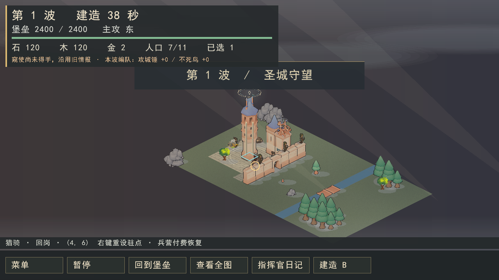
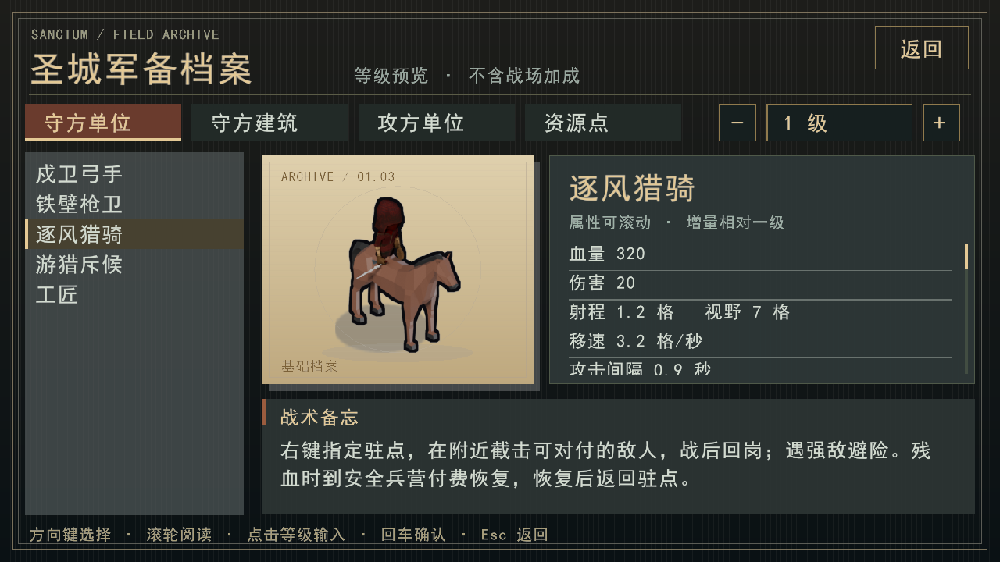

# 人口扩容与猎骑驻点、避险和恢复

本批实现 #198 中用户优先要求的人口与猎骑体验改进，基于 #202 的整合代码。数值为候选，功能验证不等于后期配平完成。

## 玩家操作与人口

普通人口由 `8+2K` 改为 `8+3K`，K 为堡垒等级。UI、征兵校验和训练环境读取同一上限；斥候（含在训）继续免人口，工匠仍占普通人口，不新增工匠比例限制。

| 堡垒等级 | 旧人口 | 新人口 |
|---|---:|---:|
| 1 | 10 | 11 |
| 5 | 18 | 23 |
| 10 | 28 | 38 |
| 20 | 48 | 68 |
| 30 | 68 | 98 |

选中猎骑后右键指定驻点，抵达后保持部署，跨波和读档保留；再次右键替换驻点。驻点高亮，底栏显示驻防、截击、回岗、避险、休整或受阻。其他兵种的临时移动语义保持现行规则，完整的多兵种驻防和护卫系统另做。

## 出击与撤回

- 不再用城墙外接矩形判断安全。猎骑围绕驻点寻找可见地面敌人，优先考虑暴露的法师、攻城锤；候选范围8格，自动接敌路径最多12格。
- 估算接近阶段承伤及交战代价，使用实际等级、当前血量、射程、攻击间隔和骑士可能的冲锋。只计已能提供火力的附近友军和建筑，不按敌我人数直接判断。
- 寻路避开实体建筑和障碍，通过实际城门绕行；没有可达路线就显示受阻，不再朝不可达目标贪心冲墙。猎骑跨格重新决策，避免高速度跳过窄巷转弯。
- 普通右键部署同样接受避险检查。没有适合的交战目标时，从可达格选择撤离路线；不强制往堡垒方向穿过敌人，脱险后至少缓冲2秒再尝试接战。
- 低于40%血量进入恢复状态，达到80%后返回原驻点。找不到安全、可达的兵营时就地避险，不为恢复穿越预计致命的道路。
- 未指定岗位的空闲猎骑仍可经安全路线处理附近清障；玩家岗位优先于自动清障。身份使用世代校验，阵亡后的新兵不会继承旧岗位。

## 兵营恢复

完工且不在维修/升级中的兵营，为2.5格内、通路无遮挡的地面战斗守军提供恢复。士兵须停止行动、不在驻墙/前摇中，且攻击或受伤后至少5秒没有再次交战；附近可见威胁会暂停恢复。

每秒恢复满血的2%（整数取整，至少1点），按实际恢复血量支付金币，恢复整条血量的计价为同级招募价的50%。不足一金币的付款余额保留在该单位身上，不能通过反复进出或读档免单。无钱不回血，多个兵营不叠加治疗；工匠、斥候不享受战斗部队恢复。猎骑会自主前往，其他战斗兵满足静止条件时也能恢复，但本批自动休整调度只接入猎骑。

本批不提高兵营的征兵速度、不改变兵营等级收益，也不增加兵种血量、伤害或移动速度。

## 验证与兼容

新增真实数值表场景覆盖：可打目标接敌、长距离目标不追、危险手动命令避险、城门巷道、封闭路线、堡垒方向有敌军时撤回、隐藏敌人不影响决策、跨波岗位、身份复用、付费恢复及恢复后回岗。人口回归验证满员拒训、在训占位和堡垒升级后新增名额；快照和操作日志均测试。

Release 构建后运行：

```powershell
build-verified/tests/rts_tests.exe '[ranger],[recovery],[econ],[script],[input]' --reporter compact
build-verified/tests/rts_tests.exe '[.rangerbench]' --reporter compact
ctest --test-dir build-verified -C Release --output-on-failure -j 3
```

验证记录（MSVC Release，前端/ONNX/bindings/training 开启、内部工具关闭）：

- 集成阶段全量 CTest 158/158 通过，580.87秒；随后补充危险休整通道、巷战和UI状态后重建，针对性83个用例、2019条断言通过；最终相关CTest 69/69通过（172.43秒），含脚本/经济/输入/存档/对局/宏观/ONNX、守方配置与图鉴渲染。
- `[.rangerbench]`：60猎骑、170×170空地、200tick移动，0.495秒，约2.475ms/tick。无敌军/密集建筑的性能诊断，不能代表后期大战帧率；不设机器相关测试阈值。
- 三张固定地图 `gen_01001000/2000/3000`、seed1、宏观守方、每图最多3波/14000tick：全部完成3波且未截断，总25442tick；结果见 [CSV](defender-population-ranger/map-smoke.csv)。不据此推断长局胜率。
- 前端1280×720实机截图已检查，岗位高亮、状态提示与图鉴说明可见。




规则升级为 World/18、Stats/15、存档基础v21（战术/宏观v22/v23）。旧存档保留供对应旧版继续，不静默迁移；真实旧RL模型不能直接用于新规则，更新的ONNX文件仅为合成测试夹具。已安装正式版与旧存档不被本批覆盖。

局部承伤估计仍不预测敌军未来包抄、友军火力的精确分配和多单位联合进攻。尚需80—90波及多地图试玩，才能判断人口和恢复价格是否合适；不宣称猎骑战术或全局配平已经完美。
