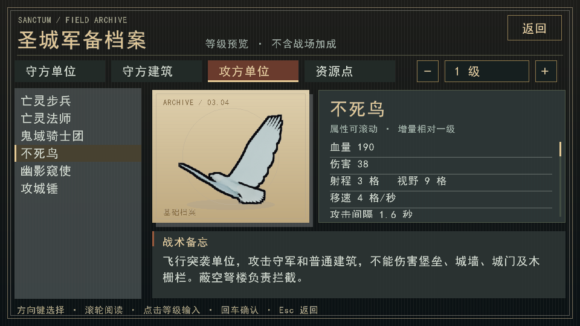

# 木栅栏攻击分类修复

## 问题

修复攻方等待时加入的通用 `AtkBld` 分支优先于继续推进；核心将木栅栏当作普通建筑，按距离选中它。因此旁边有栅栏、前方通路畅通时，敌军也会停下拆栅栏。旧测试明确要求地面单位先打最近栅栏，固化了错误分类。

## 行为

- Wall、Gate、Fence 共用 `is_fortification`，用于目标分类、结构破坏许可、范围伤害许可及寻路破障许可。
- `AtkBld` 不选择任何墙类；`AtkWall` 可以选择城墙、城门、木栅栏。
- 脚本仍按已知情报比较绕行、破障时间与承伤，不因为侧面工事在射程内就停下。选中穿过栅栏的路线时，实际移动仍触发破障攻击。
- 不死鸟不能破坏墙类，移除木栅栏兜底；防空塔仍是普通建筑攻击中的优先目标。
- 木栅栏仍不支持登墙；城门对守军通行、工事耐久和价格均不变。合法范围攻击仍可能波及附近栅栏，不能把所有栅栏掉血都解释成选错目标。

## 验证

Windows/MSVC Release修复前，新增/修正用例复现四项失败，包括侧面栅栏使亡灵步兵停在原地。

- 重建后运行 `[battlefix],[flow],[mech],[garrison],[replay],[save],[rlpolicy],[rlgoals],[phoenixraid]`：137例中136例通过；余下一例测试将亡灵法师放进堡垒射程，正确攻击堡垒却被误判为停步。
- 将该测试移到堡垒射程外，增加起始无普通建筑攻击目标的断言，重新编译后运行 `[battlefix],[flow]`：42例、1707断言全部通过。另95例在上一轮通过，其实现未再修改。这里报告相关回归，未声称全仓测试通过。
- `ctest --test-dir build-verified -C Release -R '^render_guide_19$' --output-on-failure` 通过；960×540不死鸟图鉴截图人工核验，无文字裁切。

覆盖四种地面战斗兵、三种墙类的选目标、动作掩码、实际破障与旁路推进，不死鸟目标消失后的行为，以及同血量三类工事的绕行/破障承伤比较。

## 兼容与范围

World/21，存档v33/v34/v35；Stats/15不变。旧版存档拒绝按新规则回放并保留备份，本批没有修改正在运行的试玩程序、正式版或玩家存档。已训练模型需重新评估，不通过改模型标签宣称兼容。此修复不代表攻方已具备完整的塔林战术。
