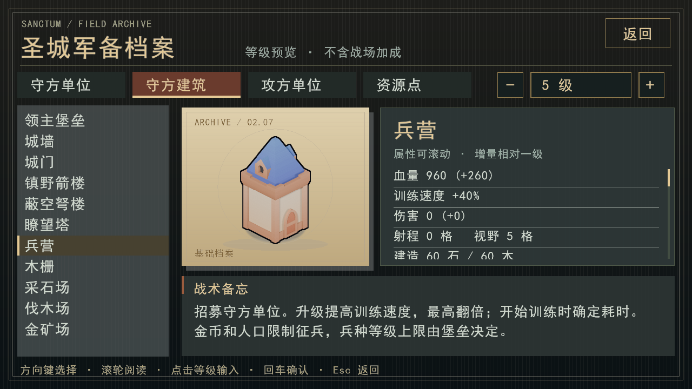

# 不死鸟拆防空、《一跃》与兵营训练

2026-09-21。基于人口、猎骑冲锋和建筑驻守分支；尚未发布。

## 不死鸟：先判断能否拔掉防空

默认编成不再用防空塔数量直接扣减不死鸟。数量仍受波次曲线、身份名额和击落后的重生冷却约束；实际出击由脚本评估。这不等于已经实现最优的空地预算分配。

候选目标来自普通编队共享的观察/记忆，以及窥使成功传输的全局建筑快照。隐藏的修复、升级或新建不会自动更新；驻墙弓手只计当前被普通战斗单位看见的个体，不从全局建筑快照获得隐藏守军位置。

每个目标比较：

- 按实际等级、目标剩余血量、攻击倍率和前摇/冷却计算拆除时间；已承诺的一击不重复计算。
- 预测与脚本一致的八方向飞行和决策间隔，累计接近途中、停留攻击时以及撤往最近集结点的防空暴露。
- 将已知防空塔和可见驻墙弓手的火力相加；目标防空塔被拆后不再贡献返程火力，其他防空继续有效。
- 预计损失后保留原有40%满血撤离余量。优先处理视野距离内的可行目标，避免为远处无关防空放过脚边安全的资源建筑；同范围先选防空塔，同类先比较预计承伤，再比较耗时。
- `AtkBld` 在射程内优先防空塔，再选可攻击的普通建筑。兵营、堡垒和墙类工事（含木栅栏）不作为不死鸟的直接攻击或追逐目标；突袭评估和探索共用此许可，兵营也不会抑制附近合法目标的评估。兵营受到溅射的规则保留。

拆掉防空后重新评估周围建筑。已知目标都不可行时撤离；无目标时保留探索行为。原有低血量、地面战斗单位耗尽及波次超时撤离继续有效。模型支持的单位仍由RL输出最终动作，本次没有训练或替换真实模型。

这是单鸟、静态火力的局部规划：不预测工匠抢修、守军未来调动、多鸟分摊火力或绕行到另一侧的最优空中路线。地面部队如何成体系拆箭塔森林仍未完成。

## 《一跃》：经历不会因击落而消失

同一跨波身份累计在**10个不同波次**发生真实交战，即获得白羽；第60波起可阅读《一跃》。交战指实际承诺攻击或受到敌方有效伤害，包含还没出手就被击落。每身份每波只计一次。

击落、冷却和重生保留累计经历；未接战撤离、仅在集结区出现不计数，不同鸟不合并。计数、当波去重和获得状态随快照保存，新局清空，开发者对局不增加进度。沿用现有日记线索和彩蛋通知，不改已审定正文。提前获得白羽时，到第60波正文可读才弹出彩蛋提示；第60波后达成则即时提示。

门槛仍是10次，改变的是不再要求连续存活。如果从第3波开始每次参战都被击落、完整跳过3波后返回，理论上第39波就可累计第10次；这是参战时序示例，不是自然对局触发率的实测结果。

## 兵营升级：缩短下一名新兵的训练时间

速度加成为 `min(100%, 10% × (兵营等级−1))`；训练计时为基础耗时除以速度倍率，向上取整到tick。所有可招募守方单位共用规则。金币、人口、兵种等级上限及同时训练一名均不变；堡垒征兵不获得此加成。

| 兵营等级 | 训练速度 | 训练计时约为原值 |
|---|---:|---:|
| 1 | 100% | 100% |
| 2 | 110% | 90.9% |
| 5 | 140% | 71.4% |
| 10 | 190% | 52.6% |
| 11及以上 | 200% | 50% |

开始训练时确定计时，之后升级不会重置或折算正在训练的进度。菜单显示该兵营的实际训练秒数，图鉴显示速度增益。两项参数在数值表中，可分别调整或关闭；这是一版保守候选，尚未证明升级比另建兵营更划算。

## 验证与兼容

局部矩阵：64×48平地，单鸟等级1/10/30/60/90，防空等级1/5/15/30，单座或两座相邻，共40组；建筑均满血，不设工匠、其他守军或其他不死鸟。种子沿用WorldInit默认值0，鸟位于(10.5,22.5)，主塔(18,22)、副塔(19,22)，撤离点(2,22)。7组判为可行，均实际拆除指定防空并存活撤回：

| 鸟等级 | 防空等级 | 座数 | 撤回剩余血量 |
|---:|---:|---:|---:|
| 30 | 1 | 1 | 291 |
| 60 | 1 | 1 | 530 |
| 60 | 1 | 2 | 350 |
| 60 | 5 | 1 | 400 |
| 90 | 1 | 1 | 682 |
| 90 | 1 | 2 | 502 |
| 90 | 5 | 1 | 614 |

复现：`build-verified/tests/rts_tests.exe '[.raidbench]' --reporter compact`。被拒绝的33组未强行出击，不能由此声称不存在错过的机会。原始日志保留在忽略的构建目录，不提交生成数据。另有拆防空后继续拆覆盖区箭楼的实际仿真，以及隐藏升级不泄露、远处防空不影响局部判断、驻墙弓手增大风险的回归。

验证使用MSVC Release，开启渲染器、ONNX、Python绑定与训练测试，重建后运行：

- `rts_tests.exe '[phoenixraid],[feather],[barrack],[battlefix]' --reporter compact`：36个用例、658条断言通过。
- `rts_tests.exe '[.raidbench]' --reporter compact`：40组矩阵、82条断言通过。
- `ctest --test-dir build-verified -C Release --output-on-failure -j1 -R '^rts_tests_all$'`：最终547个C++用例、71680条断言通过，165秒。
- `rl_suite`单独串行通过（59秒）；第一轮其余155项CTest检查通过，含存档、ONNX、Python与渲染相关检查。第一轮的沿途资源袭击回归失败已修复并复测通过；下述整局存活判据已拆为直接防空响应断言与独立配平探针。
- 1280×720兵营图鉴截图已检查；招募菜单使用同一实际训练耗时接口。`git diff --check`通过。

**开局风险仍需复核**：原宏观回归使用 `gen_01001000.json`、种子7、默认波次及守方脚本，防空参数 `flak_per_phoenix=1, flak_max=6`。当前跑到第4波陷落，防空目标已提高到3座，但实际建成0座。该结果不能证明人类玩家的开局难度，也不足以定位陷落原因；它表明不能仅凭局部拆塔实验宣称全局配平完成。原场景保留为 `[.aadefensebench]` 可复现探针；观察到0/1/2/10只不死鸟时，建造目标应准确增加并受硬顶约束，改为独立测试。

首次实现采用World/20、Stats/15，基础存档v27，战术/宏观存档v28/v29。以上实验记录对应当时版本；旧档由旧程序继续。只重新生成三个无训练权重的ONNX测试夹具，真实RL模型没有改指纹或冒充适配，发行前须单独迁移、评估。

## 2026-10-12 集成修正

集成检查发现，核心战斗已排除兵营，但不死鸟规划与探索仍会追逐它。独立复现中，鸟在兵营附近折返800tick（40秒），兵营保持700血。本次让突袭候选、候选间比较和探索共用目标许可；仅看见兵营时继续探索/撤离，附近合法箭塔不再被兵营抑制。

七个旧用例仍要求直接攻击兵营，另一个挡弹用例未产生攻击却通过。这些是目标规则改变后的回归缺口，不能归为无关的基线失败。攻击/隔墙/优先级用例现使用合法目标；挡弹用例确认已有前摇或在途弹丸，并加入无墙必能命中的对照。新增五种攻方单位不直接攻击兵营、原有攻城锤溅射仍可伤兵营的验证。

修复前新增回归有两个失败；修复后专项14个用例、401条断言通过。基础存档升为v42（战术v43、宏观v44），World/23、Stats/15不变；旧档保留供旧程序继续，不用修正后的脚本重放旧局。本次未改变兵种数值、侦查权限、未知风险参数或真实RL模型。

MSVC Release完整重建后，`ctest --test-dir build-verified -C Release --output-on-failure -j 4` 的207项全部通过（485.49秒），覆盖C++、渲染、Python/RL与存档回归。另以`RTS_INTERNAL_TOOLS=OFF`重新构建正式前端，三项`render_release_rejects_*`全部通过。测试日志留在本地QA目录，生成物不入库。
